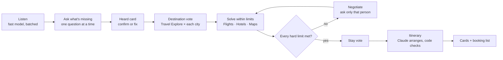

# Milo

**The trip planner that lives in your Telegram group chat.** Milo is a Telegram bot: add it to your trip group, keep chatting, and it plans a trip that works for everyone, built from real Google results via SerpApi.

## The problem

Every friend group has a trip chat where the plan never happens. Everyone says *chalo!*, but each friend's limits are scattered across the messages: Ishita's budget is "15k max", Kabir has "office till 6 on Friday", Meera is veg. Nobody wants to be the one who collects all that, searches flights from four cities and finds something that fits everyone.

## What Milo does

1. **Listens.** People chat normally. Milo reads messages in batches, picks up each friend's limits (home city, dates, budget cap, food needs, flight times, must-dos, vibe) and reacts 👀 to the messages it learned from. It stores only the extracted limits, never message text.
2. **Asks only what's missing**, one thing at a time, to the right person, with quick-reply buttons.
3. **Shows "Here's everyone."** One card with everyone's limits, hard ones marked 🔒. Only you (or whoever added you) can fix your row.
4. **Finds where the squad can afford to go**, using Google Travel Explore from every home city plus real hotel prices, then runs a vote with proxy votes, deadlines, tie-breaks and vetoes.
5. **Searches within every person's limits.** Flight searches respect each person's time limits, and hotels are capped by the tightest budget. If something has to give, **only the person affected is asked**, with real options and exact amounts: *"Ishita, Goa comes to ₹17,850 for you, ₹2,850 over your cap. A: your cheapest flights → ₹14,222…"*
6. **Builds the trip with real logistics.** Flights that land together at the same airport, a stay the group votes on, days that each stay in one area, Google Maps drive times, leave-by times, sunset timing, and a veg meal every day when someone's veg.
7. **Keeps listening after the plan.** "Add a spa session on day 3" finds a real, open, well-reviewed spa near that day's places and updates the day card, with Undo.

No commands: it's all natural language and buttons.

## How it works



**No fakes.** Every flight, hotel and place is a real SerpApi result. Claude only chooses and arranges candidates by short id; code checks every id against the search results and drops anything else. Milo's notes may only use facts from that place's own Google data, so a code check rejects any number, price, proper noun or superlative that isn't there. Places marked closed or with fewer than 100 reviews are dropped, and stops must fall inside opening hours ("hours not listed" otherwise). Every hard limit is checked for every person in code, never by the AI alone.

## SerpApi engines

| Engine | What Milo uses it for |
|---|---|
| `google_travel_explore` | Where every friend's city can fly to in India, with round-trip fares (the destination shortlist) |
| `google_flights` | One-way flights per person and direction, with `outbound_times` for limits like "no flights before 8am"; the land-together optimiser picks the combination |
| `google_hotels` | Hotels capped by the tightest budget, check-in and check-out times, cheaper stays when someone's over budget |
| `google_maps` | Sights, restaurants, interests, veg/Jain food searches, named must-dos and edits after the plan, with hours and reviews |
| `google_maps_directions` | Airport transfers and hop times between stops (at most 12 per plan, cached) |

All calls go through one client with a disk cache and a recorded demo mode, so re-running a plan costs nothing.

## Run it

You need Node 20+ and a Telegram account.

```bash
git clone <this repo> milotripplanner && cd milotripplanner
npm install
npx playwright install chromium
cp .env.example .env.local
```

### Run the real bot

1. In Telegram, open **@BotFather** → `/newbot` → copy the token.
2. In @BotFather: `/setprivacy` → pick your bot → **Disable**, so Milo can read the group chat. Or make Milo an admin of the group.
3. Put your keys in `.env.local`: `TELEGRAM_BOT_TOKEN`, `SERPAPI_API_KEY` (serpapi.com) and `ANTHROPIC_API_KEY` (console.anthropic.com).
4. `npm run bot`
5. Add the bot to a group and tap **Plan a trip ✈️**. Then just chat: who's in and from where, dates, budgets, food needs. Say "Milo, plan it" when you're ready.

Searches and Claude answers are cached on disk, so re-running a trip is free. Set `MILO_FRESH=true` to skip the cache. Both models default to Claude Haiku 5.5 (`CLAUDE_MODEL`, `CLAUDE_MODEL_FAST`) to keep costs low.

### Demo mode and the simulator

`demo-data/` holds real SerpApi responses recorded from one run of the Goa demo, so every search and card works without a SerpApi key. The simulator plays the whole demo through Milo's real handlers with a fake Telegram, using only chat messages and button taps:

```bash
npm run simulate                 # with your keys in .env.local
DEMO_MODE=true npm run simulate  # from recordings only
```

Listening and itinerary planning use Claude. To make the full demo replay with no keys at all, record it once with your keys: `npm run record-demo` saves every response the run uses into `demo-data/`, replays the demo with no keys to prove nothing is missing, and checks the recordings for key material.

### Checks

| Command | What it does |
|---|---|
| `npm test` | Voting rules, constraint checks, the flight optimiser (hard limits, same airport, nonstops), note fact-check, opening hours, money, and rendering every card from the recorded data. Never spends credits. |
| `npm run reality-check` | Re-checks the latest simulated plan against the search results: PASS/FAIL per item |
| `npm run typecheck` | TypeScript, strict |

Handy for development: `npx tsx scripts/render-samples.ts <dir>` draws every card from the demo data, and `scripts/try-search.ts`, `try-listen.ts` and `try-solve.ts` run each stage on its own.

## Tech

TypeScript (strict, ESM) · grammY (long polling, auto-retry) · Anthropic SDK (Claude Haiku 5.5, structured answers through tools, prompt caching) · SerpApi · Playwright (cards are HTML + CSS rendered to PNG in the Milo web app's design) · Leaflet + OpenStreetMap · suncalc · vitest.

```
src/core/   serpapi, queries, normalize, checks, gather, squad, solve, constraints, planner, claude, money
src/cards/  theme (design tokens + fonts), templates, render (Playwright)
src/bot/    index, conversation, listen, flow, votes, hotelvote, solving, postplan, edits, state
scripts/    simulate, record-demo, reality-check, render-samples, try-*
```

## What's next

- Conflict votes and "split the day" when the group wants different things.
- A packages vote: Budget / Sweet spot / Splurge.
- "We're running 2 hours late" re-plans of the rest of the day.
- Boarding passes in the chat and settle-up from the cost split.
